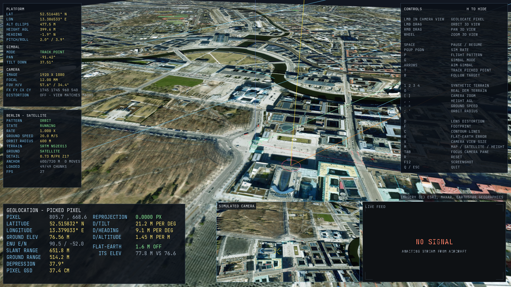
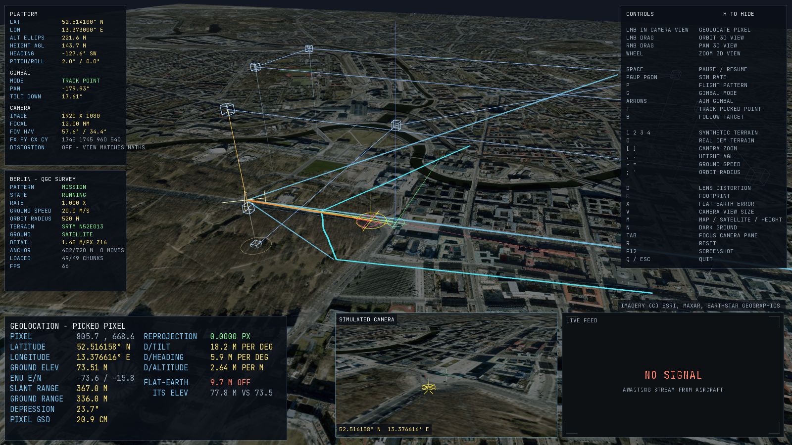
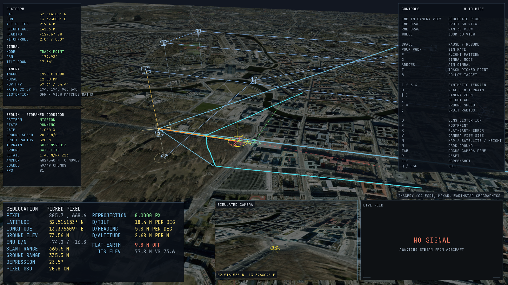
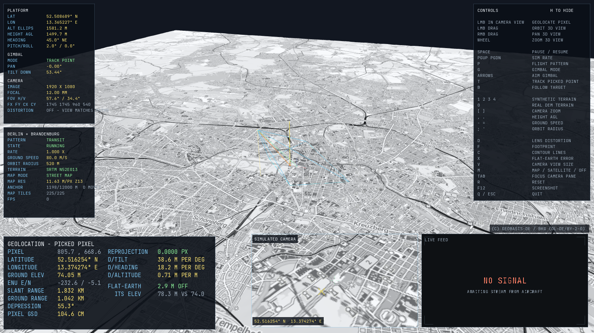
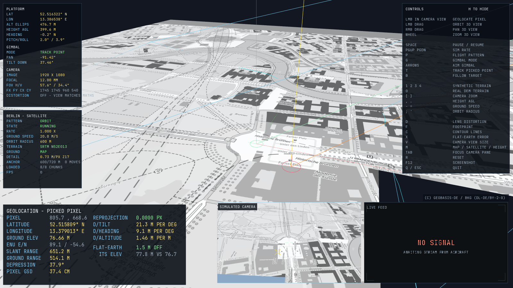
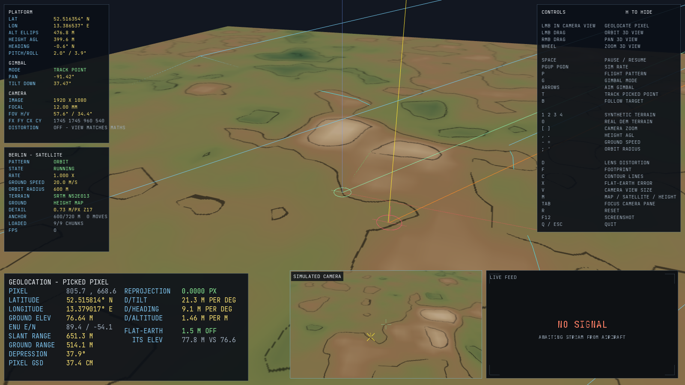
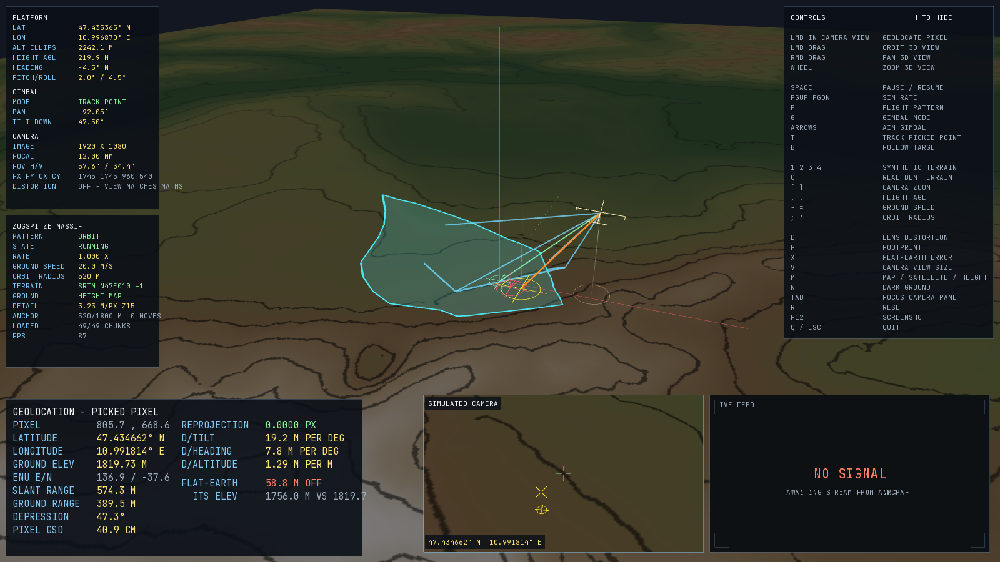

# georay

A simulation and visualisation prototype for **UAV pixel geolocation**: given a
camera's intrinsic and extrinsic parameters, the aircraft's GPS fix, altitude
and attitude, and a ground model — where on Earth is the thing in this pixel?

It is a prototype for a photogrammetry pipeline, built so the answer can be
checked rather than trusted. The window shows a 3D scene you can fly around,
and inset into it the image the simulated UAV camera is producing. Click a
pixel in that inset and georay traces the ray, intersects it with the terrain,
and reports a latitude and longitude — drawing the ray in the 3D view as it
goes. If the ray misses the feature you aimed at, you can see it.



*The default scene: satellite imagery of central Berlin on real SRTM
elevation, orbiting the Brandenburg Gate. The inset is what the UAV camera
sees; clicking a pixel in it gives the coordinate at the bottom left.*

## Building

Needs a C++17 compiler, CMake 3.16+, OpenGL, SDL2, GLEW and glm. SDL2, GLEW
and glm are used from the system if present and fetched from source otherwise,
so a bare checkout builds either way.

```bash
cmake -S . -B build -DCMAKE_BUILD_TYPE=RelWithDebInfo && cmake --build build -j
```

On Debian/Ubuntu, installing the system packages first makes configuring much
faster:

```bash
sudo apt install build-essential cmake libsdl2-dev libglew-dev libglm-dev
```

## Running

Fetch the default scene's data once, then just run it:

```bash
scripts/fetch_dem.py --origin 52.5163,13.3777 --extent 1200
```
```bash
scripts/fetch_map.py --source esri --origin 52.5163,13.3777 --extent 1200 --zoom 18 --max-tiles 800 --out data/berlin_sat.map
```
```bash
./build/georay
```

That opens on satellite imagery of central Berlin, flying a survey orbit over
the Brandenburg Gate on real SRTM elevation. Click anywhere in the camera view
and you get a coordinate you can paste into a map and check.



*A QGroundControl survey plan over Berlin: the route with a plumb line from
each waypoint to the ground, the simulated camera on the left, and the live
feed pane waiting for a real stream on the right.*

The window has two camera panes. The left one is the simulated camera — that
is the one you click in. The right one is a placeholder for an incoming stream
from a real aircraft; it reads `NO SIGNAL` until there is something to put
there. `TAB` moves focus between them, `V` enlarges the focused one.

`M` switches the ground between satellite imagery, a street map, and bare
terrain. `scenes/` holds the rest — `berlin-mission` (a QGroundControl survey
plan), `berlin`, `munich`, `zugspitze` — selected with `--scene NAME`:

```bash
./build/georay --scene zugspitze
```

With no data fetched at all, georay falls back to synthetic terrain and prints
what to run. The synthetic generators stay on keys `1`–`4` for comparing a
geolocation against made-up ground, and `0` returns to the real data.

Other modes:

| Command | What it does |
| --- | --- |
| `./build/georay --selftest` | Runs the numeric verification suite and exits. No window, no GL — works headless. |
| `./build/georay --screenshot out.bmp` | Renders a few frames, saves a BMP, exits. |
| `./build/georay --size 1920x1080` | Window size. |
| `./build/georay --scene NAME` | Load `scenes/NAME.scene`. Later flags override it. |
| `./build/georay --origin LAT,LON --extent M` | Where the scene is, and how big. |
| `./build/georay --mission FILE` | Fly a `.plan` or `.waypoints` file. |
| `./build/georay --map-mode street` | Start on the street map rather than imagery. |
| `./build/georay --map-satellite-dir DIR` | Stream imagery windows by position. |
| `./build/georay --map-street-dir DIR` | The same for the street-map layer. |
| `./build/georay --advance SECONDS` | Run the simulation forward before drawing. |

## Flight plans from QGroundControl and Pixhawk

georay flies real mission files, in both formats that are actually in use:

```bash
./build/georay --scene berlin-mission
```
```bash
./build/georay --scene berlin --mission missions/berlin-survey.waypoints
```

| Format | What it is |
| --- | --- |
| `.plan` | QGroundControl's native JSON, with the planned home position and cruise speed |
| `.waypoints` | The older `QGC WPL 110` text, which Mission Planner, MAVProxy and QGC all read, and what a MAVLink `MISSION_ITEM` stream looks like written down |

The format is chosen by content, not by extension — a `.plan` renamed to
`.waypoints` still loads, and guessing from the name is how a tool ends up
reporting "malformed JSON" about a tab-separated file. `missions/` holds the
same Berlin survey in both, which is also how the self-test checks that
neither parser has a column or array index off by one.

**The altitude frame is the part that matters.** A waypoint's `z` is
meaningless without knowing what it is measured from, and the three frames in
common use differ by tens of metres over any real terrain:

| `MAV_FRAME` | Altitude is above |
| --- | --- |
| `GLOBAL` (0) | mean sea level |
| `GLOBAL_RELATIVE_ALT` (3) | the home position — QGC's default, and what most plans contain |
| `GLOBAL_TERRAIN_ALT` (10) | the ground directly below |

Reading a relative altitude as AMSL puts the aircraft at the home elevation
plus the height: a 38 m error over Berlin and a lethal one at an alpine site.
`Mission::resolveAltitude` handles all three against the loaded terrain, and
the self-test checks that the frames are not interchangeable.

Non-navigation items — speed changes, camera triggers, jumps — are kept but
excluded from the route, because treating one as a position flies the aircraft
to latitude 0, longitude 0. Survey `ComplexItem`s are skipped: QGC expands
those itself and georay does not re-implement its pattern generator.

The route is drawn with a plumb line from every waypoint down to the ground,
which is the point — a waypoint's altitude is the thing most often wrong in a
plan, and a route drawn without them tells you nothing about height.

## Flying beyond one scene

georay works in a local ENU tangent plane, and flat ground falls away from it
as `d²/2R` — 0.5 m at 2 km, 49 m at 25 km, **4.4 km across Brandenburg**. That,
not the imagery, is what caps how far a single scene can reach.

The fix is to move the frame rather than enlarge it. The origin re-anchors to
the aircraft as it flies, so the curvature error is bounded by the *visible*
radius instead of by the size of the world — and the geolocation maths never
learns that anything changed, which is why none of it had to be touched. The
alternative, a local frame per terrain tile, would have made the ray marcher
walk between frames mid-solve; that is the most carefully verified code here
and not worth disturbing for the same answer.

```bash
./build/georay --scene berlin-corridor
```

Elevation already streams: `DemSource` loads one-degree `.hgt` tiles on demand,
so the world is as large as the tiles on disk. Imagery streams from a
**directory of overlapping windows**, fetched along a route rather than over a
bounding box:

```bash
scripts/fetch_map.py --along missions/berlin-survey.plan --window 900 --zoom 17 --source esri --out-dir data/windows
```



*`--scene berlin-corridor`: imagery streamed from a directory of windows
fetched along the QGC survey route. The HUD shows the drift from the current
anchor, how many times it has moved, and which window is resident.*

A survey running 40 km east and 2 km north has a bounding box twenty times the
area actually flown, so the corridor is the difference between a feasible
fetch and an abusive one. The HUD shows the drift from the current anchor, how
many times it has moved, and which window is resident.

**A bounded pattern never re-anchors.** An orbit sits at a constant distance
from its own centre, so a threshold below that radius would rebuild the world
every twenty seconds to move the origin somewhere no better than where it was.
The threshold sits at 0.6 of the terrain half-extent, with a dwell, so only a
flight that actually travels pays for it.

### A whole region, on the map layer

Imagery over a whole Land is not feasible — Berlin + Brandenburg at the
resolution a UAV camera resolves is 6.7 million tiles and 114 GB. A *drawn
map* is a different matter, because cartography generalises: basemap.de at
zoom 12 still shows the full street network and district labels at 23 m per
pixel, where the same ground as imagery would be unrecognisable.

```bash
scripts/fetch_map.py --region 51.36,11.27,53.56,14.77 --window 20000 --zoom 12 --source basemapde --out-dir data/berlin_brandenburg
```
```bash
./build/georay --scene brandenburg
```

That is 237 × 243 km in 72 windows — about 1,700 distinct tiles and under a
gigabyte on disk. `--region` tiles a bounding box the way `--along` tiles a
route, and the windows overlap by the same 25% so the aircraft never crosses
a seam with nothing on either side.



*`--scene brandenburg`: 40 km of ground in one window at 23 m/px, streamed
from 72 of them covering the whole Land.*

It is a *regional* view, not a camera view. At 23 m/px the simulated camera at
400 m is magnifying map pixels about fifty times; fly one of the Berlin scenes
for anything meant to be looked at. Two other things are worth knowing at this
size: the tangent plane drops about 31 m at the corners of a 20 km window
(against the region's ~100 m of relief — visible, correct, and bounded because
the frame re-anchors), and one geoid constant is good to a couple of metres
across a whole Land rather than the few centimetres it manages over a single
scene.

## The ground: three modes, streamed as you look around

The ground is a grid of flat chunks loaded around wherever the camera is
pointed — the same idea as a voxel game streaming terrain in, and for the same
reason: you can see a few kilometres, the world is a few hundred, and only the
difference needs to exist at any moment. Look somewhere new and the chunks
there appear; the ones behind you are dropped.



`M` cycles three skins:

| Mode | What it shows |
| --- | --- |
| **Map** | Official greyscale cartography — street names, building footprints |
| **Satellite** | Aerial imagery, so the camera view looks like a real UAV feed |
| **Height map** | Hypsometric colouring with contour lines, sampled from the DEM |



All three are flat, and that is deliberate. Draping a map over relief distorts
it exactly where it is most worth reading, and a map you cannot read is not
worth the parallax. **Relief has not been thrown away** — the terrain is still
what rays are intersected against, every geolocation is still fully
terrain-aware, and the height map shows the relief as colour and contours
rather than as geometry. The one thing to know is that the drawn ray ends at
the hit's true 3D position while the ground is drawn at the plane, so over
mountains the marker sits visibly above the map. The coordinates are
unaffected.

Flattening is also what makes the chunking tractable: a chunk is two triangles
and one texture rather than a patch of heightfield with its own seams, normals
and level of detail.

### Tiles arrive while you fly

Online is the default. Missing tiles are requested as the chunk builder finds
the gaps, fetched on a worker thread, and chunks re-skin as they land — the
render loop never waits on a socket. `--offline` turns it off for a demo
without a connection.

The fetcher lives in the app layer rather than in `georay_geo`, so `--selftest`
is still a pure numeric suite with nothing to reach out to. It is rate-limited,
capped per session (`--tile-limit`), identifies itself, and writes into the
same cache `scripts/fetch_map.py` uses — neither re-downloads what the other
already has.

It shells out to the `curl` binary rather than linking libcurl. That keeps the
build dependency-free, and curl handles TLS, redirects, retries and parallelism
properly. libcurl is the drop-in upgrade if the process boundary ever becomes
the limit.

The zoom follows the camera: a chunk is skinned at whichever zoom level is
nearest to what one screen pixel covers on the ground, so the map is sharp at
any distance without fetching detail nobody can see.

### Pre-fetching

Not required any more, but useful before a demo or somewhere without
connectivity:

```bash
scripts/fetch_map.py --along missions/berlin-survey.plan --window 900 --zoom 17
```
```bash
scripts/fetch_map.py --region 51.36,11.27,53.56,14.77 --zoom 12 --source basemapde --max-tiles 3000
```

| `--source` | What you get |
| --- | --- |
| `esri` | Satellite imagery, to z19 |
| `basemapde` | Official German cartography in muted greyscale, to z18. Germany only |
| `basemapde-colour` | The same, in colour |
| `osm` | OpenStreetMap's standard style — busiest of the four |

Tile servers have usage policies and they are not alike: OpenStreetMap's is
donated volunteer infrastructure and treats runs over 250 tiles as bulk
downloading, while basemap.de is a government open-data service funded to be
used. `--max-tiles` defaults to OSM's line; raise it deliberately. The
attribution for whichever source is visible is drawn on screen.

### What this is not

Vector tiles. Tiles are raster, so a zoom level has a native resolution;
zoom-matching avoids blur by fetching a finer level rather than by being
resolution-independent. True crispness at any magnification needs vector tiles
(basemap.de and OpenFreeMap both serve them, free and without a key) plus a
renderer for them: geometry decoding, tessellation, line stroking and label
placement. That is a different and much larger piece of work.

## Real elevation data

georay runs on synthetic terrain out of the box, and on real SRTM elevation
data when you give it some. Fetch tiles for an area:

```bash
scripts/fetch_dem.py --origin 48.1375,11.5755 --extent 3000
./build/georay --dem data/dem --origin 48.1375,11.5755 --extent 3000 --geoid-separation 47
```

Press `0` for the real terrain and `1`–`4` for the synthetic generators, on the
same scene — switching back and forth is the most direct way to see how much
the ground model actually changes an answer.



*Real SRTM data over the Zugspitze massif (`--origin 47.435,10.99
--geoid-separation 48`): two tiles across the 11°E seam, 2010 m of relief in a
6 km box. The flat-earth error on the picked pixel is 59 m there, against 4 m
over the Munich plain — which is the whole argument for terrain-aware
geolocation in one number.*

### Verified against published elevations

The format handling was checked against ground truth rather than only against
itself, because a misread `.hgt` produces terrain that still looks like
terrain:

| Point | georay | Published | Δ |
| --- | --- | --- | --- |
| Eibsee, lake surface | 973 m | 973 m | 0 |
| Mittenwald | 915 m | 912 m | +3 |
| Garmisch-Partenkirchen | 703 m | 708 m | −5 |
| Munich, Marienplatz | 523 m | 519 m | +4 |
| Munich airport (MUC) | 455 m | 448 m | +7 |
| Zugspitze summit | 2940 m | 2962 m | −22 |
| Ehrwald | 970 m | 996 m | −26 |

A flat lake surface is the strongest check — no slope to smooth — and it comes
out exact. The town values sit inside SRTM's ~6 m vertical accuracy, with the
positive bias at the Munich city centre and airport being what a DSM measuring
rooftops should do. The two large negatives are expected and not errors: a
30 m posting cannot resolve a knife-edge summit, and Ehrwald sits in a steep
valley where radar layover pulls the value down.

The sharpest check is the north–south gradient across `N48E011`, which falls
from 569 m near Munich to ~410 m toward the Danube. Read the rows south-first
and Munich comes out at 451 m — perfectly plausible, and 72 m wrong.

**georay itself never touches the network.** The script is the only thing that
does, and you run it deliberately; georay only ever reads local files. That
keeps the binary free of libcurl and TLS, keeps `--selftest` runnable offline,
and keeps bulk downloading something you asked for rather than something a
render loop does on your behalf.

Elevation comes from the AWS `elevation-tiles-prod` open-data bucket, which
serves SRTM in skadi layout — gzipped `.hgt`, no account, no API key. Tiles are
1° square, 3601×3601 at 1 arc-second (~30 m), about 7 MB compressed and 26 MB
on disk. SRTM covers 60°N to 56°S and has no tiles over open ocean.

### Why `--geoid-separation` is not optional

The two height systems in play are different systems. A GPS receiver reports
height above the **ellipsoid**; SRTM reports height above the **geoid**, which
is what "metres above sea level" means on a map. Near Munich they differ by
about 47 m.

Skip it and nothing looks broken — the terrain renders, the rays hit it, the
latitudes and longitudes are even correct. Only the heights are wrong, by the
separation; and since the aircraft's altitude is ellipsoidal while the ground
is orthometric, it ends up flying 47 m lower over the terrain than commanded,
which quietly changes every slant range, footprint and geolocated elevation.
The HUD shows `GEOID: NONE — HEIGHTS ARE ORTHOMETRIC` in red when it is unset.

A **single constant for the whole scene is the right answer here**, not a
shortcut: the geoid is a long-wavelength surface varying roughly a centimetre
per kilometre, so one value taken at the origin is good to a few centimetres
across a scene tens of kilometres wide — far below SRTM's own ~6 m vertical
accuracy. Rough values: ~47 m southern Germany, ~34 m Colorado, ~−30 m
southern India. `--geoid FILE` takes a full grid (converted from a
GeographicLib geoid file by `scripts/fetch_dem.py --geoid-pgm`) if you need
continental distances.

### What the DEM path guarantees

- **Heights go through the ellipsoid, not a subtraction.** Each post is
  converted geodetic → ENU through the same frame everything else uses, which
  carries the tangent-plane curvature term — flat ground 3 km from the origin
  sits 0.71 m *below* the tangent plane, and a flat subtraction would bake that
  into the terrain as a dome.
- **Voids are not zero.** SRTM's `-32768` void marker is excluded from the
  interpolation rather than read as a hole 32 km deep. Posts with no data at
  all are filled by diffusing their neighbours inwards — and the HUD then
  reports `DEM GAPS: n PCT FILLED` in red, because an interpolated post is an
  invented elevation, and that is often the right thing to do but never the
  right thing to hide.
- **Missing coverage is reported, not assumed to be sea.** A scene straddling
  a tile that is not on disk says so.
- **A failed load leaves the previous terrain alone** and falls back to
  synthetic with a message, rather than replacing the scene with a flat sheet
  of invented mean elevation that would look like a successful load of very
  boring ground.

## Controls

| Key | Action |
| --- | --- |
| Left click **in the camera view** | Geolocate that pixel |
| Left drag / right drag / wheel | Orbit / pan / zoom the 3D view |
| `Space`, `PgUp`/`PgDn` | Pause, simulation rate |
| `P`, `G`, arrows | Flight pattern, gimbal mode, manual gimbal aim |
| `T`, `B` | Track the picked point, follow the target |
| `1` `2` `3` `4` | Synthetic terrain: flat, hills, valley, mountains |
| `0` | Back to the real DEM terrain, if loaded |
| `[` `]`, `,` `.`, `-` `=`, `;` `'` | Camera zoom, height AGL, ground speed, orbit radius |
| `M`, `TAB`, `V` | Ground mode (map / satellite / height), focus camera pane, enlarge it |
| `D`, `F`, `X` | Lens distortion, footprint, flat-earth error |
| `R`, `F12`, `H`, `Q` | Reset, screenshot, help, quit |

## How the geolocation works

The pipeline lives in [`src/geo/geolocate.hpp`](src/geo/geolocate.hpp) and runs
entirely in double precision:

1. **Pixel → ray.** The pixel is un-distorted (Brown–Conrady, OpenCV's
   parameter order) and turned into a unit direction in the camera's optical
   frame — `+x` right, `+y` down, `+z` along the view axis.
2. **Optical → world.** A chain of rotations:
   `optical → gimbal → body → NED → ENU`, built from the gimbal's pan/tilt/roll
   and the aircraft's yaw/pitch/roll. The frames and their conventions are
   spelled out at the top of [`src/geo/pose.hpp`](src/geo/pose.hpp).
3. **Ray origin.** The GPS fix converted into the local ENU frame, plus the
   camera's lever arm from the GPS antenna rotated into world axes.
4. **Intersection.** The ray is marched against a sampled heightfield at half
   a grid cell per step until the first sign change of *(ray height − ground
   height)*, then bisected 50 times. Marching rather than solving, because a
   sampled DEM has no analytic form; bisecting afterwards, because a step
   coarse enough to cross kilometres would otherwise quantise the answer.
5. **Back to coordinates.** The hit point, ENU → ECEF → WGS84 geodetic.

The inverse direction — world point → pixel — is in the same file, and is what
the HUD's *reprojection* field exercises every frame.

### What it reports, and why

Besides latitude, longitude and elevation, the HUD shows the things that
determine whether a geolocation is worth anything:

- **Reprojection** — the picked point projected back through the camera, in
  pixels from where it was picked. A pipeline that cannot reproduce its own
  input has no business reporting coordinates.
- **Pixel GSD** — how wide that one pixel is on the ground, computed by tracing
  a neighbouring pixel against the tangent plane at the hit rather than by the
  textbook range/focal-length formula, which is wrong for oblique views.
- **D/tilt, D/heading, D/altitude** — how far the answer moves per degree of
  gimbal error, per degree of heading error, and per metre of altitude error.
  At a shallow depression angle a single degree is tens of metres, and no
  amount of GPS accuracy helps. This is the error budget, measured live.
- **Flat-earth comparison** (`X`) — the same pixel geolocated against a flat
  ground plane, with the horizontal distance between the two answers. On the
  mountain terrain this routinely exceeds 100 m.

## Text

The HUD renders JetBrains Mono from a bitmap atlas baked out of the TTF by
`scripts/bake_font.py`. Baked rather than rasterised at run time for the same
reason the map tiles are stitched in Python: it keeps FreeType, stb_truetype
and every other font library out of the build. It also makes the text sharper
— the atlas is rendered at exactly the pixel sizes the HUD draws at and
sampled 1:1, so glyphs land on whole pixels instead of being resampled.

Three sizes are baked (11, 15, 22 px): a footnote size, the readout size, and
a heading size. Anything in between would just be a blurred version of one of
them, so the renderer takes a named face rather than a scale factor. The
output is committed, so nobody needs the script to build or run georay — only
to change the sizes:

```bash
scripts/bake_font.py assets/fonts/JetBrainsMono-Regular.ttf
```

A 3×5 font is still compiled in as a fallback. If the atlas is missing, a HUD
of tiny capitals beats a window with no text, and georay says which font it is
using so the fallback never looks like a rendering bug.

JetBrains Mono is under the SIL Open Font License 1.1; the licence travels
with it in `assets/fonts/OFL.txt`.

## Verification

`--selftest` runs ~8600 numeric checks with no window and no GL, so it runs in
CI and on headless machines. It is also wired up as a CTest test
(`ctest --test-dir build`).

Every error in a tool like this is silent — a transposed matrix or a sign slip
produces a confident latitude that is simply somewhere else — so the suite
pins the conventions down with cases whose answers are known independently of
the code:

- Geodetic ↔ ECEF against points on the ellipsoid with known coordinates, and
  round trips to a micrometre over the whole globe.
- ENU axis directions: `+latitude` is north and not east, `+longitude` is east,
  `+altitude` is up by exactly that much.
- The rotation chain: nadir is nadir, yaw 90° looks east, every composition is
  orthonormal with determinant `+1`, and `aimGimbalAlong` inverts the chain.
- The whole pipeline against the closed-form plane intersection over flat
  ground, to a micrometre, for thousands of random poses.
- Round trips over all four terrain types, with and without lens distortion:
  geolocate a pixel, project the answer back, land within a tenth of a pixel.
- Failure modes: a ray above the horizon and a ray that leaves the DEM tile are
  reported as *different* things, because only one of them is fixed by loading
  more terrain.
- The rendered simulated-camera view against the geolocation maths, so what you
  click is what is computed.
- The DEM path, against synthetic `.hgt` files whose heights encode their own
  post indices — pinning the big-endian byte order, the north-first row order
  (flip it and the terrain still looks like terrain, just mirrored), void
  handling, tile selection across hemispheres, and continuity across a tile
  seam. The resampling is checked against the closed-form curvature drop
  `d²/2R` and against gradients computed from metres-per-degree, so none of it
  is verified by re-running the code under test.

The DEM tests build their own tiles rather than downloading one: a test that
needs 7 MB fetched from AWS is a test that gets skipped.

## Known limitations

These are deliberate, and each is where a production pipeline would differ.

- **The ground model is a DTM, not a DSM.** Rays intersect terrain, not the
  structures standing on it. Click the top of one of the towers and you get the
  ground *behind* it. That is left visible on purpose: it is the single largest
  error source in real oblique geolocation.
- **The rendered view cannot show lens distortion.** A projection matrix is
  linear. With distortion on (`D`), the maths models a distorted camera while
  the picture stays an ideal pinhole render, so the two diverge towards the
  frame edges — the HUD says so while it is active. Fixing it properly means
  rendering to a texture and warping it.
- **SRTM is a 2000-vintage radar DSM at ~30 m posting**, with roughly 6 m
  vertical accuracy, and over forest and cities it measures the canopy and
  rooftops rather than the ground. A photogrammetry pipeline that cared would
  use a modern lidar DTM where one exists.
- **No basemap keeps up with a low-flying camera.** At 400 m the camera's own
  GSD is about 44 cm — so flying lower
  magnifies map pixels rather than resolving more ground. The HUD shows both
  numbers so the limit is visible. This is inherent to draping a fixed raster,
  not a flaw to be fixed.
- **Berlin's own 20 cm orthophotos would beat all of this** and are openly
  licensed, but they are served over WMS rather than XYZ tiles, and every
  endpoint name I tried returned 404. Adding WMS to `fetch_map.py` is a
  contained job — one more URL builder, the same tile grid, the same output —
  and would roughly triple the usable resolution.
- **Only SRTM `.hgt` is read.** Copernicus GLO-30 and most national products
  ship as GeoTIFF, which needs a TIFF reader this deliberately does not have.
  The conversion would belong in `scripts/fetch_dem.py`, where the messy
  formats already live, writing the same simple arrays the C++ side reads.
- **No atmospheric refraction**, which bends a long slant-range ray by a metre
  or so near the ground.

## Layout

```
src/geo/      the geolocation maths, and the DEM/geoid/map readers - no GL
              anywhere in it, and a separate CMake target so it stays that way
src/gl/       thin OpenGL wrappers: shaders, buffers, the text renderer
src/render/   terrain mesh, 3D overlays, the orbit camera
src/          the application: window, input, HUD, flight simulation, selftest
shaders/      GLSL
assets/fonts/ JetBrains Mono, its licence, and the baked atlas
scenes/       ready-made scenes: berlin-satellite, berlin-mission,
              berlin-corridor, berlin-transit, berlin, munich, zugspitze
missions/     the same survey plan in both QGC formats
scripts/      fetch_dem.py and fetch_map.py (the only things here that touch
              the network), and bake_font.py
```
